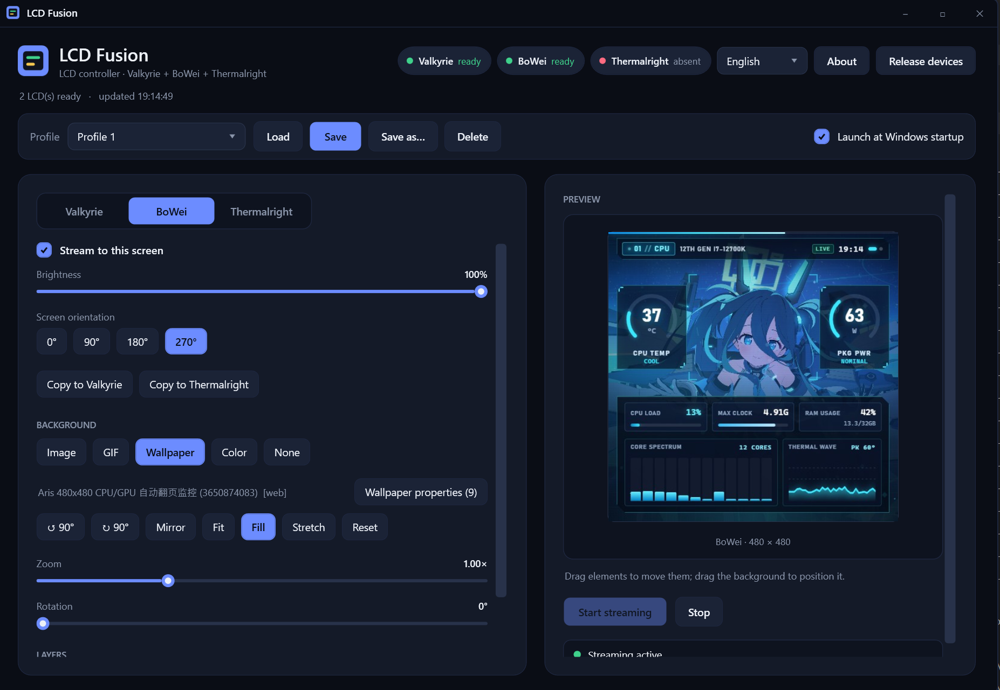

# LCD Fusion

**A standalone Windows (x64) controller for AIO‑cooler LCD screens — drive them without the vendor software.**

LCD Fusion talks directly to the USB displays found on **Valkyrie** (Myth.Cool / MSDisplay & BoWei) and **Thermalright** (TRCC) all‑in‑one coolers, so you can show images, GIFs, **Wallpaper Engine dynamic wallpapers** (via an optional separate renderer), custom text, and **live CPU/GPU sensors** without keeping the vendor apps running.

> Unofficial, community project. Not affiliated with or endorsed by Valkyrie, BoWei, Thermalright, Myth.Cool, TRCC, or Wallpaper Engine.

## Screenshots




---

## Features

- **Per‑screen editor** — configure Valkyrie, BoWei, and Thermalright LCDs independently (each with its own background, layers, transforms, and screen orientation).
- **Rich backgrounds** — static image, animated GIF, **Wallpaper Engine dynamic wallpapers (`scene`, `video`, `web`)**, solid color, or none, with **rotation (any angle), mirror, zoom, `Fit` / `Fill` / `Stretch` (independent X/Y scaling and edge/corner drag), and free drag‑to‑pan**.
- **Settings & power / iGPU optimization** — dedicated **Settings** dialog supporting **Render GPU selection** on multi‑GPU PCs (Vulkan / WebView2 / Media Foundation), **PC display‑off behavior** (`Run normally`, `Pause` closing the wallpaper renderer to 0% GPU/VRAM while keeping the last frozen frame on every LCD, or `Stop`, with auto‑resume on wake), and live‑applied **wallpaper FPS cap (`Default / 24 / 20 / 15 / 10 FPS`)** & **render resolution scaling (`100% / 75% / 60% / 50%`)** while keeping text/sensor overlays at 100% native panel sharpness.
- **Valkyrie multi‑panel & BoWei support** — automatic/manual Valkyrie panel timing selection (`360×960`, `320×240`, `480×480`, `240×320`, `240×240`, `480×272`), plus native BoWei (`Vk-Copl-08`) `480×480` streaming with brightness control.
- **Layers** — movable text and **sensor widgets** (CPU/GPU temperature, load, clocks, power, GPU HotSpot / memory clock / fan %, RAM, clock, date) that you can drop **on top of any background**, each with its own size, rotation, and color. Drag on the live preview to position them.
- **Live sensors, self‑contained** — reads CPU/GPU/RAM metrics via the bundled [LibreHardwareMonitorLib](https://github.com/LibreHardwareMonitor/LibreHardwareMonitor) (with HWiNFO shared memory and WMI fallbacks); no external monitoring tool required.
- **Profiles** — save complete multi‑screen layouts (images/GIFs embedded; wallpaper paths & custom properties persisted). The last session is restored automatically on the next launch.
- **Streaming on by default**, remembered per profile/session.
- **Launch at Windows startup** (optional) and **minimize to the system tray** (pauses preview rendering while continuing to stream).
- **Multilingual UI** — Italiano / English / Deutsch / **简体中文**, switchable at runtime.
- **Refined dark UI**, native x64 build with zero extra NuGet runtime bloat.

## Supported hardware

| Brand / app                       | Panel / Model                           | VID / PID   | Resolution                                                          | Transport                                       |
|-----------------------------------|-----------------------------------------|-------------|---------------------------------------------------------------------|-------------------------------------------------|
| Valkyrie / Myth.Cool              | Valkyrie / MSDisplay LCD                | `345F:9132` | Multi‑panel (`360×960`, `320×240`, `480×480`, `240×320`, `240×240`, `480×272`) | HID init + bulk UYVY frames                     |
| Valkyrie / Myth.Cool (BoWei)      | Vk‑Copl‑08 Waterblock LCD               | `374A:A005` | `480 × 480`                                                         | WinUSB, raw BGR565‑LE frames (~30 fps) + brightness |
| Thermalright / TRCC               | Thermalright AIO LCD                    | `0416:5408` | `1920 × 462`                                                        | WinUSB, JPEG frames                             |

The registry of supported products and Valkyrie panel timings lives in [`LcdFusion/ProductCatalog.cs`](LcdFusion/ProductCatalog.cs) — see [Adding a new product](#adding-a-new-product).

## Wallpaper Engine dynamic wallpapers (optional)

LCD Fusion supports Wallpaper Engine **`scene`**, **`video`**, and **`web`** wallpapers from your local Steam Workshop (`431960`) or custom directories, including live custom property editing, audio spectrum reactivity, and hardware sensor forwarding.

To maintain strict **MIT / GPL‑2.0 license isolation** and privilege separation, dynamic wallpaper rendering is handled by a separate out‑of‑process renderer repository: **[YuukiNoa/LcdFusion-WpeRenderer](https://github.com/YuukiNoa/LcdFusion-WpeRenderer)** (GPL‑2.0, x64).

1. Obtain or build `wpe-renderer.exe` from [LcdFusion-WpeRenderer](https://github.com/YuukiNoa/LcdFusion-WpeRenderer).
2. Place it next to `LcdFusion.exe` at:
   ```text
   <LcdFusionDir>\renderer\wpe-renderer.exe
   ```
   (or select its path manually inside LCD Fusion's Wallpaper dialog).
3. Ensure Wallpaper Engine is installed via Steam on your PC; LCD Fusion reads your local Steam Workshop (`431960`) and `wallpaper_engine\assets` at runtime and **never bundles or distributes any Wallpaper Engine assets**.

When `LcdFusion.exe` runs elevated under UAC (High Integrity), it automatically de‑elevates `wpe-renderer.exe` to **Medium Integrity** using `explorer.exe`'s desktop token, binds it to a Windows Job Object for zero‑orphan cleanup, and communicates over scoped‑DACL named pipes (`--ipc-pipe`) and double‑buffered BGRA32 shared memory.

## Requirements

- Windows 10 / 11 (**x64**).
- .NET Framework 4.8 (ships with Windows 10/11).
- **Administrator rights**: the app requests elevation (UAC). This is required so LibreHardwareMonitor can load its kernel driver and read CPU temperatures (e.g., Ryzen Tctl/Tdie). GPU temperature works without elevation.
- The display interface must be bound to a generic USB driver:
  - **BoWei** (`374A:A005`) uses in‑box **WinUSB**.
  - **Thermalright** (`0416:5408`) uses **WinUSB**.
  - **Valkyrie** (`345F:9132`) uses **libusb/WinUSB** on interface 3 (the display interface) plus a normal **HID** interface for control. If your panel isn’t detected, bind the display interface with [Zadig](https://zadig.akeo.ie/).
- Close the vendor software (Myth.Cool / TRCC) before streaming — they hold the USB device. The app has a **“Release devices”** button for this.
- *(Optional, for Wallpaper Engine `web` wallpapers)* Microsoft Edge WebView2 Runtime (built into Windows 10/11).

## Run

Build it (below) and run `LcdFusion\bin\Release\LcdFusion.exe` (or `Debug`). Keep these next to the exe:

```text
LcdFusion.exe
LibreHardwareMonitorLib.dll
HidSharp.dll
LibUsbDotNet.LibUsbDotNet.dll
renderer\wpe-renderer.exe          # optional, from LcdFusion-WpeRenderer (GPL-2.0)
```

Profiles and settings are stored under `%APPDATA%\LcdFusion\` (`profiles\*.xml`, `last-session.xml`, `settings.xml`). Autostart is implemented as a Scheduled Task (`LCDFusionAutostart`) with highest privileges, so the elevated app starts at logon without a UAC prompt.

## Build from source

SDK‑style project targeting **.NET Framework 4.8** (WPF + Windows Forms, **x64**). With the [.NET SDK](https://dotnet.microsoft.com/download) installed:

```powershell
dotnet build LcdFusion/LcdFusion.csproj -c Release
# or produce the MIT portable zip (exe + dependencies; excludes GPL wpe-renderer.exe):
./pack.ps1 -Version 1.0.15
```

`LibUsbDotNet` is restored from NuGet; `LibreHardwareMonitorLib` and `HidSharp` are referenced from `tools/librehardwaremonitor/`. `pack.ps1` intentionally excludes any `wpe-renderer.exe` binary and writes a `renderer\README.txt` explaining how to install the optional GPL‑2.0 renderer separately.

---

## How it works

```text
MainWindow ──> ContentEngine ──> ValkyrieDirectService     (HID init + bulk UYVY, multi-panel)
  (WPF UI)        (renders     ├─> BoWeiDirectService      (WinUSB + BGR565-LE + brightness)
  + Wallpaper      scenes &    ├─> ThermalrightDirectService (WinUSB + JPEG)
    Catalog        overlays)   ├─> SensorService           (LibreHardwareMonitorLib / HWiNFO / WMI)
                               └─> WallpaperRendererIpc    (Medium-Integrity named pipe + BGRA32 SHM)
                                     └─> wpe-renderer.exe  (optional GPL-2.0 child process)
```

- **`ContentEngine`** holds one `LcdScene` per screen (`Valkyrie`, `BoWei`, `Thermalright`), composites the active `IBackgroundSource` (`StaticImageSource`, `GifState`, or `WallpaperFrameSource`) with sensor/text overlays at the panel’s native resolution on a worker thread, and pushes frames to the device services. It also drives the live preview and forwards sensor snapshots to dynamic wallpapers.
- **`*DirectService`** classes own one USB protocol each. They expose a simple “show this frame” API and run their own streaming loop.
- **`WallpaperCatalog` & `WallpaperRendererIpc`** discover Steam Workshop (`431960`) / local Wallpaper Engine projects, parse `project.json` user properties, manage the de‑elevated renderer child process (Shell token + Job Object + exponential‑backoff crash recovery), and read tear‑free frames from double‑buffered shared memory.
- **`SensorService`** reads CPU/GPU/RAM values (LibreHardwareMonitor first, then a running HWiNFO shared‑memory block or OHM/LHM WMI as fallbacks), including CPU name, per‑core load averaging, package/PPT power, GPU HotSpot, memory clock, and fan percentage.
- **`Theme.cs`** is the dark design system (a XAML `ResourceDictionary` parsed at startup); **`Loc.cs`** is the string table (`it` / `en` / `de` / `zh`); **`ProfileService.cs`** serializes scenes (with embedded images/GIFs and wallpaper property overrides) to XML.

### Protocol notes

- **Valkyrie (`345F:9132`)**: probes panel Flash/serial info (`ValkyrieHidInitializer`) to auto‑detect the active panel timing (or uses a user‑selected panel key from `ProductCatalog.ValkyriePanels`), sends the HID feature‑report init sequence, then streams UYVY frames over bulk endpoint `0x04` with periodic `B5 00 32` HID heartbeats (~250 ms).
- **BoWei (`374A:A005`)**: connects via in‑box WinUSB (interface GUID `{D6A0CF3F-3825-4BD5-BB19-AAE43828058C}`, bulk OUT `0x02` / IN `0x81`), performs handshake/info commands, streams `480×480` raw BGR565‑LE frames at ~30 fps with ZLP alignment and pipe‑reset recovery, and supports live hardware brightness (`0x0002`).
- **Thermalright (`0416:5408`)**: performs a `02 FF` handshake, then streams JPEG frames (quality 90, `1920×462`) split into 512‑byte packets over WinUSB, each frame ACKed, at a steady ~156 ms cadence.

---

## Contributing

Contributions are very welcome — bug fixes, translations, UI polish, and **new product support**.
Issues/PRs in English, Chinese, Italian, or German are all fine.

### Adding a translation

Add a dictionary to [`LcdFusion/Loc.cs`](LcdFusion/Loc.cs) and an entry to `Loc.Codes` / `Loc.Names`. Every UI string goes through `Loc.T("key")`, so a new language is just a copy of an existing dictionary with translated values.

### Adding a new product

Most AIO LCDs from these brands speak one of a handful of USB protocols. Adding one is usually:

1. **Identify the device.** Find its `VID:PID` (Device Manager → Details → Hardware Ids) and panel resolution. Add an entry to [`LcdFusion/ProductCatalog.cs`](LcdFusion/ProductCatalog.cs).
2. **Does it match an existing protocol?** If the framing/format matches an implemented panel (e.g., another MacroSilicon / Valkyrie panel timing or Thermalright JPEG panel at a different resolution), you can often reuse `ValkyrieDirectService` / `BoWeiDirectService` / `ThermalrightDirectService` with the new catalog entry.
3. **New protocol? Reverse it from a USB capture:**
   - Capture USB with [USBPcap](https://desowin.org/usbpcap/) / Wireshark while the vendor app drives the panel.
   - Analyze with the helpers in [`tools/`](tools): `parse-usbpcap.ps1` (summarize endpoints, dump control/bulk transfers) and `extract-valkyrie-init.ps1` (extract an ordered command sequence). They already understand the USBPcap link type.
   - Diff a working capture against a black/idle one to find the missing init/commit commands.
   - Implement a `FooDirectService` exposing the same shape as the existing services (`Show…()` + a streaming loop + `Stop()`), and have `ContentEngine` push to it.
4. **Wire it into the engine/UI.** `ContentEngine` renders a `Bitmap` at the panel’s size — convert it to the panel’s pixel/wire format inside your service.

If you have a panel but can’t capture it, open an issue with the `VID:PID`, a photo, and the vendor app name — someone with the hardware may help.

### Project layout

```text
LcdFusion/                        # main application (.NET Framework 4.8, x64)
  LcdFusion.csproj                # SDK-style project (net48, x64, WPF + WinForms)
  app.manifest, app.ico           # UAC elevation manifest + icon
  MainWindow.cs                   # WPF UI, preview editor, settings, wallpaper & property dialogs
  Theme.cs                        # dark design system (XAML resource dictionary)
  Loc.cs                          # i18n string tables (it / en / de / zh)
  ContentEngine.cs                # multi-screen scene model, Fit/Fill/Stretch, display-off & perf controls, frame pushing
  BackgroundSource.cs             # IBackgroundSource (StaticImageSource, GifState)
  GpuCatalog.cs                   # DXGI GPU adapter enumeration & renderer GPU payload resolution
  WallpaperCatalog.cs             # Steam Workshop (431960) & project.json scanner
  WallpaperRendererIpc.cs         # IPC v1 host (Shell de-elevation, named pipes, Job Object, SHM)
  ValkyrieDirectService.cs        # Valkyrie HID + bulk UYVY multi-panel driver
  BoWeiDirectService.cs           # BoWei WinUSB BGR565-LE driver (480x480 + brightness)
  ThermalrightDirectService.cs    # Thermalright WinUSB JPEG driver (1920x462)
  SensorService.cs                # CPU/GPU/RAM sensors (LibreHardwareMonitor + HWiNFO/WMI)
  ProfileService.cs               # profile + settings persistence (XML, embedded media, wallpaper props)
  AutoStartService.cs             # launch-at-logon (Scheduled Task)
  ProductCatalog.cs               # supported hardware & Valkyrie panel catalog
  DeviceService.cs, VendorService.cs
  licenses/                       # third-party license texts
protocol/
  ValkyrieHidInitializer.cs       # Valkyrie HID init & panel timing probe
tools/
  librehardwaremonitor/           # LibreHardwareMonitorLib.dll + HidSharp.dll
  wpe-renderer-mock/              # 64-bit C# mock renderer for IPC v1 testing
  extract-valkyrie-init.ps1       # USB init sequence extractor
  parse-usbpcap.ps1               # USBPcap capture analyzer
```

## Third‑party

- **LibreHardwareMonitorLib** — MPL‑2.0. https://github.com/LibreHardwareMonitor/LibreHardwareMonitor
- **HidSharp** — Apache‑2.0 / MIT. https://www.zer7.com/software/hidsharp
- **LibUsbDotNet** — LGPL‑3.0. https://github.com/LibUsbDotNet/LibUsbDotNet

License texts are in [`LcdFusion/licenses/`](LcdFusion/licenses). These components are redistributed as binaries; their licenses apply to them.

## Legal & licensing

Short version: this project is lawful to build, use and publish.

- **Interoperability.** LCD Fusion was built by *observing* the USB traffic of the vendor apps (black‑box) and re‑implementing the display protocol to interoperate with hardware **you own**. In the EU this is explicitly permitted — Software Directive 2009/24/EC, Art. 5(3) (observe/study/test) and Art. 6 (decompilation for interoperability) — and EULA clauses forbidding it are unenforceable for that purpose (Art. 8). No vendor source code, binaries, firmware or assets are copied or redistributed. Protocols, interfaces and file formats are not themselves protected by copyright (cf. CJEU C‑406/10, *SAS Institute v World Programming*).
- **Trademarks.** “Valkyrie”, “BoWei”, “Thermalright”, “Myth.Cool”, “TRCC”, and “Wallpaper Engine” are used only descriptively to indicate compatibility (nominative/referential use). This is **not** an official product and is not affiliated with or endorsed by those vendors; no vendor logos are used.
- **MIT / GPL‑2.0 separation & zero bundled Wallpaper Engine assets.** LCD Fusion (MIT) communicates with the optional external renderer [LcdFusion-WpeRenderer](https://github.com/YuukiNoa/LcdFusion-WpeRenderer) (GPL‑2.0) solely as an independent child process over the public IPC protocol. Neither repository bundles or distributes Wallpaper Engine official assets or Workshop content.
- **No DRM is circumvented** and **no personal data is processed** (no telemetry, no network calls).
- **Bundled OSS** keeps its own licenses — LibreHardwareMonitor (MPL‑2.0), HidSharp (Apache‑2.0), LibUsbDotNet (LGPL‑3.0) — shipped as separate, replaceable DLLs; see [`THIRD_PARTY_NOTICES.md`](LcdFusion/THIRD_PARTY_NOTICES.md).
- **Use at your own risk.** Provided “as is” (MIT, no warranty). Driving the LCD directly may affect a device’s warranty.

*This is an informed summary, not legal advice.*

## License

Released under the [MIT License](LICENSE) © 2026 itsmylife44 (fork modifications © 2026 YuukiNoa). The bundled third‑party components keep their own licenses (listed above and under [`LcdFusion/licenses/`](LcdFusion/licenses)).
